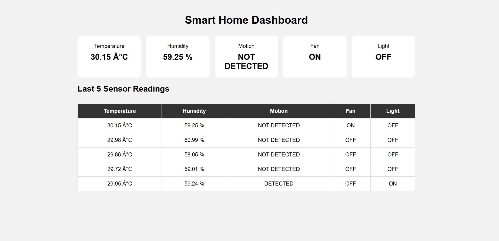
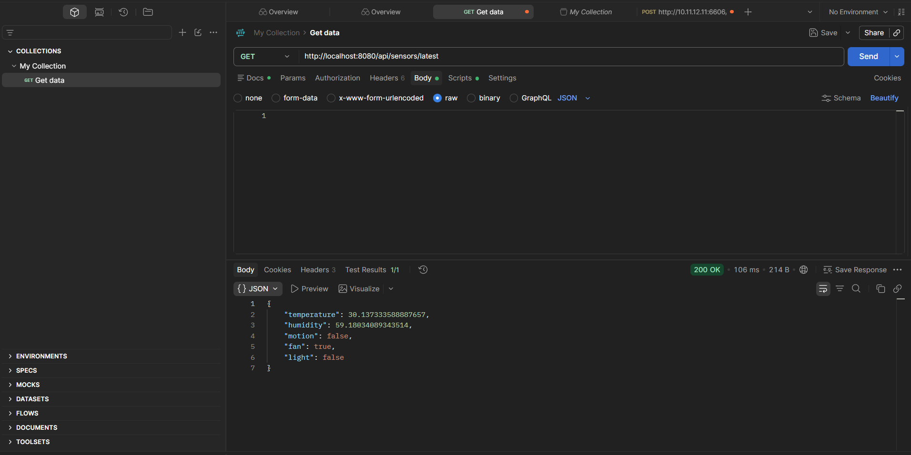

# 🏠 Smart Home IoT Monitoring & Automation System

A Java-based smart home monitoring system that simulates IoT sensor readings, automates connected devices, stores sensor data in MySQL, and provides a REST-style API with a live web dashboard.

<p align="center">
  
</p>

## 📌 Overview

This project demonstrates how a smart home system can monitor environmental conditions and automate devices using Java. Simulated sensor readings are processed by the application, saved to MySQL, and displayed through a web dashboard.

> **Note:** Sensor readings are currently simulated. The software is structured to support integration with real IoT hardware or an external sensor API in the future.

## ✨ Features

* 🌡️ Temperature and humidity monitoring
* 🚶 Motion detection simulation
* 💡 Automatic light control based on motion
* 🌀 Automatic fan control based on temperature and humidity
* ⚠️ High-temperature and high-humidity alerts
* 🗄️ MySQL database storage using JDBC
* 🔌 REST-style API returning JSON
* 📊 Web dashboard with automatic refresh
* 📜 Recent sensor-reading history

## 🛠️ Technologies Used


## 🖥️ Dashboard Preview

The dashboard displays the latest sensor readings and the current fan and light states.


## 🔗 API Preview

The API exposes sensor readings as JSON for testing with Postman or consuming from another application.

**Latest Sensor Reading**

`GET /api/sensors/latest`



## 📡 API Endpoints

| Method | Endpoint               | Description                             |
| ------ | ---------------------- | --------------------------------------- |
| GET    | `/api/sensors/latest`  | Retrieves the latest sensor reading     |
| GET    | `/api/sensors/history` | Retrieves the five most recent readings |
| GET    | `/`                    | Opens the web dashboard                 |

## 🏗️ Architecture

```text
Simulated IoT Sensors
        ↓
   IoTDataSource
        ↓
     SensorData
        ↓
  Java Automation Logic
        ↓
      MySQL
        ↓
  Java HTTP API Server
        ↓
   Web Dashboard / Postman
```

## ⚙️ Prerequisites

* Java Development Kit (JDK)
* MySQL Server
* MySQL Connector/J
* Postman (optional, for API testing)

## 🚀 How to Run

1. Create a MySQL database named `smart_home`.

2. Create the `sensor_data` table with the columns required by the application.

3. Configure the database URL, username, and password in `Main.java` and `SimpleApiServer.java`.

4. Ensure the MySQL Connector/J JAR is available in the `lib` folder.

5. Compile the source files from the project root:

   ```powershell
   javac -cp "lib\mysql-connector-j-26.7.0.jar;src" -d bin src\*.java
   ```

6. Start the sensor simulation and database writer:

   ```powershell
   java -cp "lib\mysql-connector-j-26.7.0.jar;bin" Main
   ```

7. In a separate terminal, start the API server:

   ```powershell
   java -cp "lib\mysql-connector-j-26.7.0.jar;bin" SimpleApiServer
   ```

8. Open the dashboard in your browser:

   `http://localhost:8080/`

## 🔮 Future Improvements

* Integration with physical IoT sensors
* Device-control API endpoints
* Migration to Spring Boot and PostgreSQL
* Improved validation and automated testing

---

## 📁 Project Structure

```text
SmartHome/
├── .vscode/
│   └── settings.json
├── lib/
│   └── mysql-connector-j-26.7.0.jar
├── src/
│   ├── Main.java
│   ├── Device.java
│   ├── Sensor.java
│   ├── MotionSensor.java
│   ├── SensorData.java
│   ├── IoTDataSource.java
│   ├── Dashboard.java
│   ├── DatabaseManager.java
│   ├── DatabaseRead.java
│   └── SimpleApiServer.java
├── dashboard/
│   └── index.html
├── screenshots/
│   ├── dashboard.png
│   └── api-response.png
├── .gitignore
└── README.md
```
**Developed as a Java-based IoT monitoring and automation project.**
